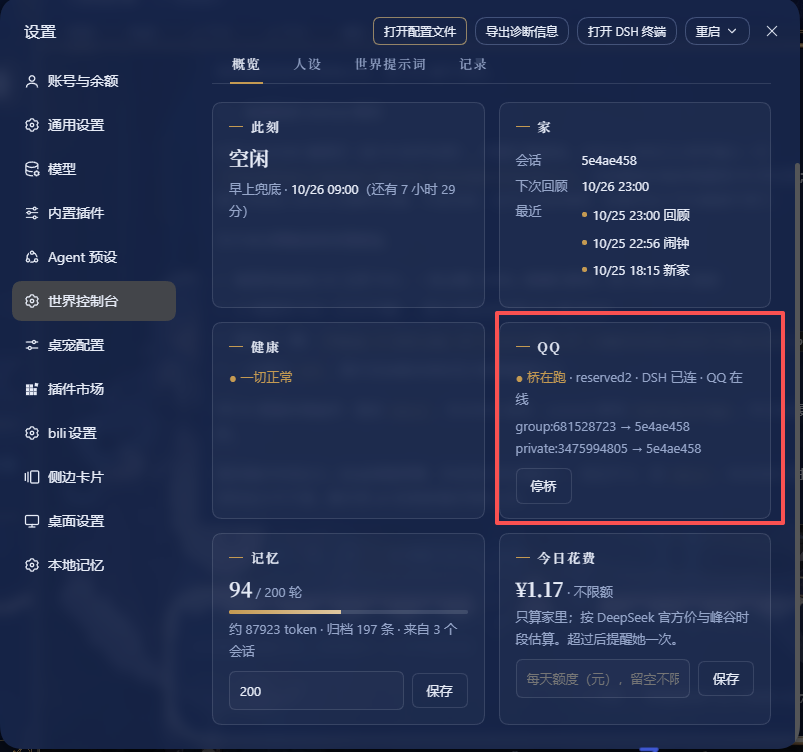

# dsh-world

给 DSH 里的陪伴角色一个会记得、会生活的世界。

装上以后，她会记得你们在每个窗口里说过的话；有一个自己的家，自己决定接下来做什么、做到几点，想你了会主动来找你；每天晚上回想这一天，写日记，也改写一份关于自己的自述。开关和人设都在 DSH 设置里的「世界控制台」，由你掌握。

插件只用 DSH 原本开放的扩展接口，不改宿主的一行代码。

## 她能做到什么

### 记得：像人一样记

- **近期记忆**：你们最近数轮的对话原文，每次开始对话和每次压缩之后都放在她眼前，谁、什么时候、说了什么，一字不差。轮数在控制台里填，默认 200。
- **日记**：人生里重要的事，她自己写进日记，一天一篇。这是她的长期记忆。
- **我是谁**：她写给自己的一份自述，随着她变化而改写。每晚回顾前，插件会留一份当时的版本，改过的都找得回来。
- **相册**：你给她看的图里，她觉得值得留的，可以当场用 `keep_photo` 留一份副本进房间的「相册」文件夹，`相册.md` 记着日期、标题和她当时写下的话。同一张图只留一次；会话被压缩或删掉，照片也还在。需要宿主的图片存储。
- **全部原文都留着**：每句话都按天归档。近期记忆以外的事，她可以自己去翻。

日记和自述都由她自己动笔，插件从不替她写。

**为什么不用向量库或记忆系统？** 一个人的生活，量没有那么大。在这个量级上，把原文留在眼前、需要时按原话去找，比切碎了再拼回来更准，也少一道会出错的环节。可参考：

- Chan et al., 2024. *Don't Do RAG: When Cache-Augmented Generation is All You Need for Knowledge Tasks*. arXiv:2412.15605
- Sen et al., 2026. *Is Grep All You Need? How Agent Harnesses Reshape Agentic Search*. arXiv:2605.15184

### 生活：她自己的日子

- **家**：她有一个自己的会话「<名字>的家」，和一个房间（工作目录），在里面过自己的日子。
- **自己定节奏**：她说好接下来做什么、做到几点，到点了再决定继续还是换一件。什么都不定，就休息到第二天早上。
- **主动找你**：想你的时候，她可以把一句话送到你面前（Windows 系统通知，或你接上的桌宠等程序）。
- **每日回顾**：每天晚上 23:00，她回想当天的聊天和做过的事，写日记，更新「我是谁」。
- **每天额度**：可以给家里每天的花费设个上限，超过了会提醒她一次，由她自己决定收尾。
- **大事先问**：删改房间外的文件、装软件、花钱、以你的名义对外发消息等，约定好先问你。

### 世界控制台：开关在你手里

DSH 设置里的「世界控制台」：

- **开始 / 停止**：按下开始，她才住进来；按下停止，记忆、人设和生活线一起安静下来，家还在，等你回来。
- **人设**：分层写她是谁：名字、她是谁、性格、说话方式、愿景、补充，旁边实时预览她读到的样子。
- **世界提示词**：你想对她说的话，以及她的世界的说明。
- **概览与记录**：她此刻在做什么、下个闹钟、近期记忆有多少轮、今天花了多少；还有活动记录、日记和压缩记录。

### 只留下你们之间的话的压缩

对话太长需要压缩时，dsh-world 自带的压缩方式会去掉工具调用的过程，把你们之间的交流整理成一段摘要。她记住的是你，不是那些命令。

### 桌宠和其他程序

dsh-world 开放了一个本地的「桥」：桌宠之类的程序可以把你说的话送进她的家，也可以接收她的回复和主动找你的话。协议见文末。

之后还会接上微信和 B 站。

### QQ

装了 [qq-bridge](https://github.com/Derpyu520/qq-bridge) 并配上 `qqBridgeDir` 之后，控制台里会多一张 QQ 卡片：桥在不在跑、DSH 有没有连上、QQ 号在不在线、哪几个入口（群或私聊）绑到了哪个会话，一眼看到；拉起桥、停桥也在那儿按。没配 `qqBridgeDir` 的时候这一块整个不出现，行为跟以前一样。

插件每次启动都会把 DSH 当前的地址写回桥的 `config.json`（`dsh.baseUrl`）。原因是 DSH 每次重启都换端口，而桥没有别的地方知道新端口——地址旧了不会报错，只会静静连不上，看起来和桥本身挂掉一模一样。

桥还是那个独立进程，代码不在这里：插件只负责探活、拉起、停掉、绑定和报告，不复制它的逻辑。



## 安装

需要 DSH 桌面版，世界控制台和生活线都依赖它。

**最省事的办法**：把这个仓库地址交给她，让她照着下面的步骤自己装。

**自己装**：

```powershell
npm ci
npm pack
```

用 DSH 自带的 pnpm 把生成的 `dsh-world-*.tgz` 装进你的 profile。不要用 `link:` 指向项目目录，否则会加载项目自己的一份 Cordis。装好后重启 DSH，打开设置里的「世界控制台」，写好人设，按「开始」。

**换用只留对话的压缩方式**（可选）：

```powershell
powershell -NoProfile -ExecutionPolicy Bypass -File .\scripts\enable-tool-free-compaction.ps1 -profilePath '<你的 DSH profile 目录>'
```

脚本会把 profile 里原版的压缩条目换成 `dsh-world/compaction`，并留一份备份。

## 设置

大多数东西在世界控制台里改。其余的写在 profile 的 `cordis.patch.yml` 里，按 id 覆盖插件那一行，只写想改的项：

```yaml
- id: dsh-world
  name: dsh-world
  config:
    companionName: 小鱼          # 她的名字（控制台人设里写了名字时以人设为准），默认 TA
    partnerName: 伙伴            # 她对你的称呼，默认 伙伴
    worldId: default             # 世界名；换一个就是另一个世界、另一份记忆
    agentPreset: standard        # 她所在的预设
    timeZone: Asia/Seoul         # 默认系统时区
    life: true                   # 生活线，默认开启
    archiveScope: world          # world：所有会话都记；home：只记家里
    fallbackWakeTime: '09:00'    # 没定闹钟时，早上几点叫醒她
    diaryDir: C:/path/to/日记    # 日记目录，默认在世界目录里
    toast: true                  # 主动找你时发 Windows 系统通知
    bridge: false                # 打开本地的桥
    outlets: []                  # 接收她的话的本地程序，见文末
    allowedHosts: []             # 通过反向代理从局域网访问控制台时，放行的域名或 IP
    qqBridgeDir: ''             # qq-bridge 所在的目录；留空就是不接 QQ
    qqBridgePort: 3100          # 桥的控制台端口
    qqBridgeNode: ''            # 用哪个 node 拉起桥，默认用当前进程那个
    qqBridgeAutoStart: false    # 世界开始时顺手拉起桥；默认关，只在控制台里手动拉
```

**改她的措辞**：世界提示词可以直接在控制台里改。闹钟响时、提前停下时、每日回顾时她收到的话，在世界目录里放一份 `alarm.md` 就能按段覆盖，段落名和可用的占位符见 `templates/alarm.md`。插件写给她的话一律用第一人称「我」，读起来是她自己的念头。

**时间**：建议把预设里 `time-context` 条目的 `refreshIntervalMs` 设为 `0`，让她每一步都知道现在几点。

## 她的东西放在哪

都在 `<DSH_HOME>/worlds/<worldId>/` 下（`DSH_HOME` 默认是用户目录下的 `.dsh`）：

| 位置 | 是什么 |
|---|---|
| `conversations/` | 按天归档的聊天原文（给人看的导出，正本在 `archive.sqlite`） |
| `room/` | 她的房间；`room/我是谁.md` 是她的自述 |
| `diary/` | 她的日记（可用 `diaryDir` 换位置） |
| `persona.md`、`world-prompt.md`、`alarm.md` | 你写给她的人设、世界提示词和闹钟措辞 |
| `world.json` | 世界是否在运行、每天额度、近期记忆轮数 |
| `activity/` | 她在家里用过的工具，只记录，不进记忆 |

备份时整个目录一起备份即可，最好先停止 DSH。

## 桥与推送协议

给桌宠等本地程序用。

**把话送进她的家**（`bridge: true`）：插件启动时写出 `<世界目录>/bridge.json`，内容是 `{ origin, token, name, ... }`。向 `POST {origin}/dsh-world/bridge/say` 发 `{ "text": "..." }`，请求头带 `x-dsh-world-token: <token>`，会立即返回 `202`。这句话会作为你本人说的话进入她的家和记忆。

**接收她的话**（`outlets`）：每个目标写一个 `name`，地址用 `url`（其中 `{origin}` 会被替换），或者用 `urlFile` + `path`（端口会变的程序用这个）；再用 `kinds` 选择要接收哪些：`reply` 是桥上那句话的回复，`busy` 表示她正忙，`reach` 是她主动找你。插件会向目标 `POST`：

```json
{ "text": "她的话（纯文本）", "kind": "reply", "name": "她的名字", "images": ["http://…"], "image": "表情名" }
```

目标回复 2xx 就算送到。送不到的会显示在控制台的「健康」里。

## 许可

MIT
